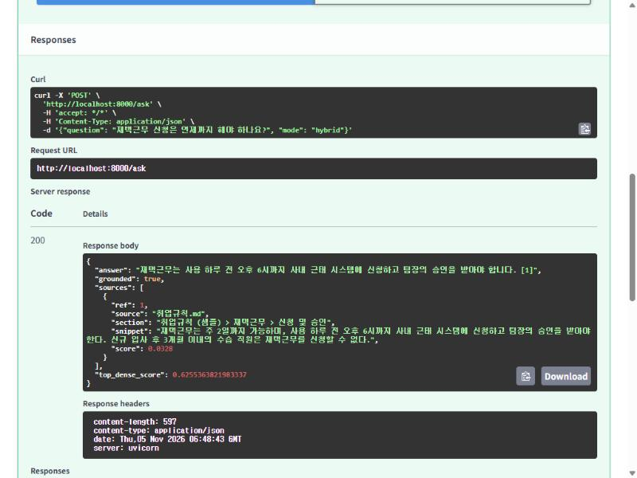

# Local RAG Assistant

**외부 API 없이 로컬 LLM(Ollama)만으로 동작하는 온프레미스 사내 문서 QA 서비스**

보안상 문서를 외부로 보낼 수 없는 환경(제조·금융·공공)을 가정했습니다. 화려한 기능보다 **검색 품질을 측정하고, 환각을 막고, 한계를 수치로 기록하는 것**에 초점을 맞췄습니다.

> 샘플 문서(`data/docs`)는 포트폴리오 시연용으로 만든 가상의 회사 "누리테크" 규정입니다.

## 한눈에 보기

| 항목 | 내용 |
|---|---|
| 스택 | Python, FastAPI, Ollama (`embeddinggemma`, `kanana2:3b`), rank-bm25, numpy |
| 검색 | BM25(문자 bigram) + 벡터 검색을 RRF로 결합 |
| 신뢰성 | 답변마다 출처 표기, 근거가 약하면 LLM 호출 없이 "근거 없음" 응답 |
| 평가 | 골든셋 18문항으로 hit@k, MRR, 답변 정확도, 거절율 측정 |
| 결과 | 검색 hit@4 1.00 · 답변 정확도 0.67 · 근거 없음 거절율 1.00 |
| 배포 | Dockerfile (Ollama는 호스트에서 실행) |

## 동작 예시



현재 코드로 실제 실행한 결과입니다 (CPU, `kanana2:3b`).

```
Q: 재택근무 신청은 언제까지 해야 하나요?
A: 재택근무는 사용 하루 전 오후 6시까지 사내 근태 시스템에 신청하고 팀장의 승인을 받아야 합니다. [1]
   [1] 취업규칙.md > 신청 및 승인

Q: 사내 주차장 이용 규칙을 알려줘
A: 제공된 문서에서 해당 내용의 근거를 찾을 수 없습니다.      ← 문서에 없는 내용은 지어내지 않음

Q: SEV1 장애가 나면 몇 분 안에 대응을 시작해야 하나요?
A: 30분                                                      ← 오답 (정답: 5분, 30분은 임시 복구 목표)
   [1] 장애대응매뉴얼.md > 등급별 대응 시간
```

세 번째가 실패 사례입니다. 검색은 정확한 섹션을 가져왔지만 3B 모델이 같은 문장 안의 두 숫자를 혼동했습니다. 아래 "한계"에서 다룹니다.

## 구조

```
질문 ─▶ 임베딩 ─▶ ┌ 벡터 검색 (cosine) ┐
                   │                    ├─ RRF 결합 ─▶ Top-K ─▶ 근거 충분? ─▶ LLM(출처 [n] 강제) ─▶ 답변 + 출처
질문 ─▶ 토크나이즈 ▶ └ BM25 (문자 bigram) ┘                      └ 아니오 ─▶ LLM 호출 없이 "근거 없음"
```

| 파일 | 역할 |
|---|---|
| `api.py` | FastAPI 서버 (`/ask`, `/reindex`, `/health`) |
| `rag/chunker.py` | 마크다운 헤딩 인식 청킹 (청크마다 "문서 > 섹션" 경로 유지) |
| `rag/index.py` | BM25 + 벡터 하이브리드 검색, RRF |
| `rag/pipeline.py` | 근거 판단, 프롬프트, 출처 추출 |
| `rag/ollama_client.py` | 임베딩/생성 클라이언트 |
| `eval/run_eval.py` | hit@k, MRR, 답변 정확도, 거절율 |

## 실행

```bash
python -m venv .venv
.venv\Scripts\activate
pip install -r requirements.txt

ollama pull embeddinggemma
ollama pull kanana2:3b        # 또는 CHAT_MODEL 환경변수로 다른 모델 지정

uvicorn api:app --reload      # http://localhost:8000/docs
```

```bash
curl -X POST localhost:8000/reindex
curl -X POST localhost:8000/ask -H "Content-Type: application/json" -d "{\"question\": \"연차는 며칠 부여되나요?\"}"
```

GPU에서 CUDA 오류가 나면 `OLLAMA_NUM_GPU=0`으로 CPU 전용 실행이 가능합니다. 설정은 모두 환경변수로 바꿀 수 있습니다(`rag/config.py`).

## 평가

```bash
python -m eval.run_eval          # 검색 평가
python -m eval.run_eval --e2e    # + 답변 정확도, 거절율
```

골든셋은 18문항(답변 가능 12 + 근거 없음 6)입니다.

**검색** (CPU, embeddinggemma)

| mode | hit@4 | MRR |
|---|---|---|
| bm25 | 1.00 | 0.94 |
| dense | 1.00 | 1.00 |
| hybrid | 1.00 | 1.00 |

**종단** (`--e2e`, 생성 모델 `kanana2:3b`)

| 단계 | 답변 정확도 | 근거 없음 거절율 |
|---|---|---|
| 1. 기준선 (엄격한 키워드 채점) | 0.42 (5/12) | 1.00 (3/3) |
| 2. + 프롬프트 개선, 유사도 상대 필터 | 0.75 (9/12) | 0.67 (2/3) |
| 3. + `MIN_DENSE_SCORE` 0.30 → 0.45, 미사용 질문 3개 추가 | 0.67 (8/12) | 1.00 (6/6) |

**무엇을 했고 왜 그랬나**
1. 검색 hit@4가 1.00이므로 기준선의 병목은 생성 모델이었습니다. 근거가 있는데도 거절하거나, 같은 근거 안의 다른 숫자를 골랐습니다.
2. 질문과 무관한 청크를 컨텍스트에서 제외하고(최고 유사도 -0.10 이내, 최대 3개), 거절 조건을 "관련 내용이 전혀 없을 때만"으로 좁혀 정확도를 올렸습니다.
3. 그러자 모델이 "주차장 이용 규칙" 같은 질문에 문서 속 무관한 시각을 가져다 지어냈습니다(거절율 0.67). 유사도 임계값을 올려 막았습니다. 답변 가능 질문의 최저 유사도는 0.48, 지어낸 질문은 0.42였습니다.

## 한계

- **임계값 0.45는 이 작은 문서 집합에서 정한 값**이고 여유가 0.03뿐입니다. 문서가 바뀌면 다시 보정해야 합니다. 보정에 쓰지 않은 질문 3개는 모두 거절되었지만 표본이 작습니다.
- **정확도 수치는 ±1문항(±0.08) 흔들립니다.** 12문항이고 생성 온도 0.1이라, 2단계와 3단계의 0.75 → 0.67 차이가 임계값 때문인지 변동인지 구분할 수 없습니다.
- **문서 3개(21청크)와 쉬운 질문**이라 검색 방식 간 차이가 거의 드러나지 않습니다. 실제 PDF와 어려운 질문(동의어, 여러 섹션에 걸친 질문)으로 골든셋을 키워야 합니다.
- **3B 모델은 한 문장 안의 비슷한 숫자를 혼동합니다.** 위 SEV1 사례가 그 예입니다.

## 로드맵

- [ ] 답변이 인용 문장에 실제로 들어 있는지 검증하는 후처리
- [ ] 7B급 모델 비교
- [ ] Reranker(bge-reranker 등) 추가 후 hit@k / 지연시간 트레이드오프 측정
- [ ] Qdrant 등 벡터 DB로 교체 (현재는 numpy 인메모리)
- [ ] 임베딩 모델 비교 (bge-m3, KURE 등)
- [ ] 표·이미지가 포함된 PDF 파싱
- [ ] 질문 분해/재검색을 하는 Agentic RAG
- [ ] 스트리밍 응답, 간단한 웹 UI

## 라이선스

[MIT](LICENSE)

## 이 주제를 고른 이유

2026년 11월 사람인(567건)과 잡코리아(457건)의 `RAG LLM` 검색 결과에서 반복되는 요구사항에 맞췄습니다.

| 공고에서 반복되는 요구 | 이 프로젝트에서 보여주는 것 |
|---|---|
| Python + FastAPI로 LLM 서비스 구축 | `api.py` |
| RAG 검색 품질 (Vector DB, 하이브리드, 검색 엔진) | BM25 + 벡터 + RRF, 모드별 비교 평가 |
| 온프레미스 / 보안 / 사내 LLM | Ollama 로컬 모델만 사용, 외부 전송 없음 |
| 환각 방지, 신뢰성 | 근거 없음 거절, 출처 인용 |
| Docker / 배포 | `Dockerfile` |
